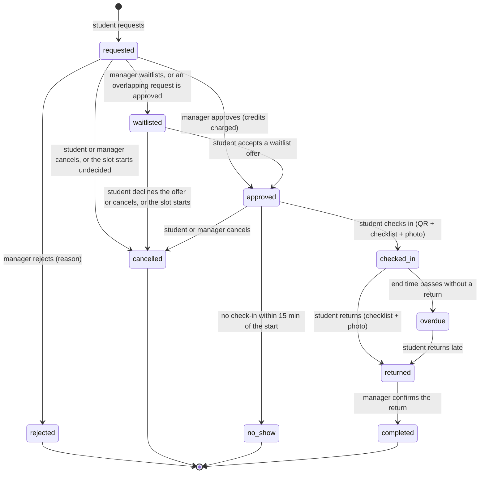
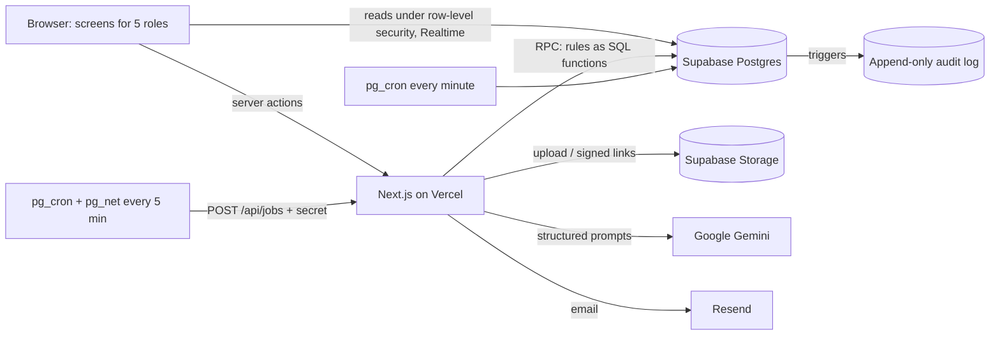

# LabPass — Project Document

> LabPass lets departments of one university share idle labs, rooms and equipment with students from any department, using a skills passport, peer supervisors, an explainable fairness score, photo-backed handovers and an Idle Radar dashboard.

**Team:** kulez team · **Live link:** https://lab-pass-rho.vercel.app · **Repository:** https://github.com/mudit08d24-cpu/LabPass · **Demo video:** _TODO_

---

## 1. Use case and problem

University departments own labs, rooms and equipment that sit idle for long periods, while students in other departments who need them can't reach them. Equipment tends to be tied to the group that bought it, so it is used below capacity and bought twice instead of shared (see the sources in section 3). Two things block sharing:

1. **No trust layer.** Owners have no way to check a borrower's training, track who used what, or prove the condition before and after use. Students have no visibility of what other departments have.
2. **Supervision bottleneck.** Specialised equipment needs a supervisor, and staff are free only a few hours a day, so the equipment stays locked even when demand is high.

**Primary persona.** Priya, a second-year CSE student, needs an oscilloscope for her project; the one she needs sits unused in the ECE lab most afternoons.

**Owner persona.** Mr Rao, the ECE lab manager, is willing to share but needs to know each borrower is trained and accountable.

**Goals:** let any verified student find and safely use idle resources from any department; keep owners in control, with every access decision made or confirmed by a person; allocate scarce resources fairly and explain every allocation; create new usable hours through peer supervision; and keep a complete, tamper-proof record of every booking.

The 48-hour build covers one fictional university (Northfield Institute of Technology), three departments and six demo resources.

## 2. Users and owners

Five roles, enforced in the database with row-level security. One person can hold more than one role; for example, a student can also be a peer supervisor.

| Role | Who | Can do | Cannot do |
| --- | --- | --- | --- |
| Student | Any verified student of the university | Browse, take quizzes, upload certificates, book, check in, return, report issues, dispute decisions, see own history | See other users' details, approve anything |
| Peer supervisor | Tier 2 student approved for a specific resource | Everything a student can, plus publish supervision hours and co-sign check-in and return for that resource | Approve bookings, decide incidents |
| Owner | Department head or representative | List and edit the department's resources; set rules, tiers, limits and checklists; assign managers | Act on other departments' resources |
| Manager | Lab staff for the owner's resources | Approve, reject or waitlist requests; confirm returns; review certificates; approve and suspend supervisors; decide incidents | Change audit records, act outside assigned resources |
| Admin | Platform administrator | See all resources and bookings, Idle Radar, suspicious-pattern flags; confirm restrictions; resolve disputes | Edit or delete audit records |

As built, `profiles.roles` holds `student`, `manager` and `admin`. Owners are the people named in `departments.owner_id`, and peer supervisors are students with an approved row in `supervisor_approvals`. Route access is checked in `proxy.ts` and again by the database.

## 3. Evidence

| Source | What it shows |
| --- | --- |
| [CU Boulder Environmental Center — Equipment Sharing and Efficient Space Use](https://www.colorado.edu/ecenter/programs/cu-green-labs-program/equipment-sharing-efficient-space-use) | A university sustainability office argues that labs should turn underused equipment into shared resources: sharing avoids duplicate purchases, lab space is expensive to build and run, and shared facilities give researchers access to equipment regardless of which group they belong to. |
| [Lab Manager — Creating Highly Specialized Core Labs from Aging, Underused Spaces](https://www.labmanager.com/creating-highly-specialized-core-labs-from-aging-underused-spaces-32968) | Lab architects describe universities converting underused space into shared "core" labs, which give researchers tools they couldn't fund alone, and note that renovating is often more cost-effective than building new. |
| [The Asia Business Daily — Opening of University Research Infrastructure (29 May 2026)](https://view.asiae.co.kr/en/article/2026052912524106923) | Korea's national equipment registry lists 93,480 research equipment items, 22,335 (24%) owned by universities. Equipment tied to individual professors' labs leads to duplicate purchases and underuse; one university's instrument worth 1.8 billion won sat idle for years. The government plans to open university equipment for sharing and to survey idle equipment from 2027. |
| [St Petersburg University — It Is Time to Collect and Use Scattered Equipment (2015)](https://english.spbu.ru/news-events/fresh-start/it-time-collect-and-use-scattered-equipment) | A university found that equipment outside its shared research centres was scattered across rooms, often missing from inventory, used below capacity and lacking documentation. It proposed an open equipment database, clear usage rules and schedules so researchers from other teams could use it — the same gap LabPass addresses with one shared catalogue, booking rules and access tiers. |

## 4. Solution overview

LabPass is one web app where every department lists what it can share and any verified student can find it, prove they're trained, book it and hand it back with photo evidence. Owners keep control: every access decision is made or confirmed by a person, every rule is enforced by the database, and every action is recorded. AI helps with suggestions but never decides.

- **Skills passport (Tiers 0–3).** Each resource has a tier, and students earn badges per resource: Tier 0 is open to any student, Tier 1 needs a 5-question safety quiz, Tier 2 needs a certificate approved by the manager (or graduation from Tier 3), and Tier 3 is supervised use only. Every listing shows where the student stands and the next step.
- **Peer supervisors.** Trained Tier 2 students apply to supervise a resource, publish their available hours, co-sign handovers and earn credits. Tier 3 students can book inside those hours, which unlocks equipment that would otherwise wait for staff.
- **Explainable fairness score.** Contested slots go to the highest priority score (fresh to the resource, verified deadline, hours already used, recent no-shows), shown with its full breakdown to the student and the manager. Hard limits on active bookings, weekly hours and credits stop anyone taking everything.
- **Photo-backed handovers.** Check-in by QR code with a checklist and photos; return with a checklist and photos; the manager confirms. Damage becomes an incident with evidence, decided by a person with a reason, and the student can dispute it.
- **Idle Radar.** A dashboard of utilisation, peak and dead hours, no-show rate, waitlist length, bottlenecks and hours unlocked by peer supervision.
- **Audit log.** Every state change is written to an append-only log (who, what, reason, before, after, when), so each booking has a full timeline.

## 5. Workflow (the booking journey)

1. **List.** A department owner lists a resource: type, tier, limits, opening hours, handover checklist, photos and a printable QR code.
2. **Discover.** A student browses every department's resources, filters them, or describes a need and gets AI suggestions. Each listing shows whether they can book it, or what they need first.
3. **Qualify.** Tier 1: pass the safety quiz. Tier 2: upload a certificate for the manager to approve, or graduate from Tier 3. Tier 3: book with a staff or peer supervisor whose published hours cover the slot.
4. **Request.** The student picks a slot and a purpose and sees every check, the credit cost and their priority score before sending.
5. **Approve.** The manager approves, rejects or waitlists, with a reason. Approving charges the credits and moves overlapping requests to the waitlist.
6. **Check in.** From 15 minutes before to 15 minutes after the start, the student scans the QR code (or types the code), ticks the checklist and adds a photo. A peer supervisor co-signs.
7. **Return.** The student ticks the checklist again and adds a photo; the manager confirms the return.
8. **Incident.** Damage, delay or a missing item becomes an incident with photos. The manager decides with a reason (optionally after an AI summary and photo comparison), and the student can respond or dispute.
9. **History.** Every step is in the booking's timeline from the audit log, visible to the student and the manager.

### Booking states



| Status | Meaning | Moves on when |
| --- | --- | --- |
| `requested` | Waiting for the manager | Approved, rejected, waitlisted or cancelled; cancelled automatically if the slot starts first |
| `waitlisted` | A competing request was approved | The student accepts an offer (→ approved), declines it or cancels (→ cancelled), or the slot starts (→ cancelled) |
| `approved` | Confirmed; credits charged | Check-in (→ checked_in), cancel (→ cancelled, refunded if more than 2 hours before or cancelled by the manager), or no check-in within 15 minutes (→ no_show) |
| `checked_in` | In use | Return (→ returned), or the end time passes (→ overdue) |
| `overdue` | Past the end without a return | Return (→ returned) |
| `returned` | Handed back; waiting for the manager | The manager confirms (→ completed) |
| `completed` | Closed; a peer supervisor who co-signed both reports earns credits | — |
| `rejected`, `cancelled`, `no_show` | Closed, always with a reason | — |

When an approved booking is cancelled or becomes a no-show, the slot is offered to the top-ranked waitlisted student for 30 minutes (or until the start, if sooner). Overdue, no-show, reminders, offer expiry and stale requests are handled by a database job every minute; every status change writes a row to the audit log.

## 6. Features
<!-- Owner: all. P0 / P1 / P2 features that actually work in the demo. Screenshots from C. -->

## 7. Tech stack and architecture

| Layer | Choice |
| --- | --- |
| App | Next.js 16 (App Router, server actions), React 19, TypeScript |
| UI | Tailwind CSS 4, shadcn/ui, Radix UI, lucide-react |
| Database | Supabase Postgres: business rules as SQL functions, row-level security, audit triggers, exclusion constraints against double booking |
| Auth | Supabase Auth (email and password, with email confirmation through a one-time link that works in any browser or device: `/auth/confirm`) |
| Files | Supabase Storage: public resource photos; private condition photos and certificates |
| Live updates | Supabase Realtime on bookings, waitlist offers and notifications; the browser hands Realtime the signed-in user's token before subscribing, so row-level security delivers that user's rows |
| Scheduled jobs | pg_cron in the database every minute; pg_cron + pg_net calling the app's `/api/jobs` every 5 minutes |
| AI | Google Gemini through the Vercel AI SDK, structured output checked with zod |
| Email | Resend HTTP API, from `labpass-team.xyz` |
| Hosting | Vercel (auto-deploy from `main`, preview per pull request) |

### Architecture



**Data flow.** Screens read data directly from Supabase, where row-level security returns only what that role may see. Every write goes through a Next.js server action, which calls a Postgres function. That function checks every rule (eligibility, conflicts, limits, credits), changes the data, queues a notification, and writes the audit log through a trigger. The server action turns any refusal into plain-language reasons. AI calls run only on the server; their results are saved as labelled suggestions and never change a booking. Every 5 minutes, `/api/jobs` sends queued emails, deletes condition photos past their 30-day retention, and raises usage-pattern flags.

**Performance.** The browser runs server actions one at a time, so screens that need many checks batch them into one call (for example, Browse loads every listing's eligibility with one `getMyEligibilities` call instead of one per card). The business rules (`labpass_config()`) are public numbers, read with the server's key so the landing page works for signed-out visitors.

### Data model (18 tables, plus `ai_outputs` for AI audit)

| Area | Tables |
| --- | --- |
| People and departments | `profiles` (name, roll number, department, roles, credit balance, block), `departments` (owner) |
| Resources | `resources` (type, tier, limits, checklist, deposit, status, photos), `availability_slots` (opening hours), `resource_checkin_codes` (QR codes, no read access for students) |
| Skills passport | `badges`, `user_badges` (quiz, certificate or graduation; AI extraction), `quizzes` |
| Supervision | `supervisor_approvals`, `supervisor_slots` (published hours) |
| Bookings | `bookings` (time range, status, checks, priority score and breakdown, credits), `waitlist_offers`, `condition_reports` (check-in and return checklist, photos, co-signatures) |
| Incidents and penalties | `incidents` (type, evidence, AI summary and photo diff, decision, dispute), `user_flags` (no-show and usage-pattern flags) |
| Credits and messages | `credits_ledger` (every charge, refund and top-up), `notifications` |
| Audit | `activity_log` (who, what, reason, before, after, when; append-only) |

Two exclusion constraints in `bookings` make double booking impossible in the database: no two active bookings can overlap on the same resource, and no supervisor can be in two sessions at once. All rule numbers live in one function, `labpass_config()`.

## 8. AI and external services
<!-- Owner: D. For each AI feature: what it does, model used, data sent, who decides. Every output labelled "AI suggestion — needs review", stored in ai_outputs, never changes a booking by itself; flows continue if AI fails. Also: Supabase, Vercel, Resend. -->

**Model:** Google Gemini (Flash family) through the Vercel AI SDK (`ai`, `@ai-sdk/google`). The model name is set by the `GEMINI_MODEL` environment variable, with a default in `lib/ai.ts`. Every call asks for structured output validated by a zod schema and uses a low thinking setting so answers come back quickly. Calls time out after 50 seconds (25 seconds for smart matching, where the student is waiting); if the model rejects the thinking setting, the call is repeated once without it. Photos and PDFs are sent as file parts.

| AI feature | Where | Data sent to the model | Output | Who decides |
| --- | --- | --- | --- | --- |
| Smart matching | Student → Browse → "Suggest" | The student's typed need (max 500 characters) and the list of active resources (name, type, tier, location) | Up to 5 resources, each with a one-sentence reason | The student chooses; if the AI fails, a keyword match is shown instead |
| Certificate review | Manager → Certificates → a submission → "Read certificate with AI" | The uploaded certificate (PDF or image) and the resource name | Name, course, issuer, date, relevance; mismatch checks (name vs profile, future date, unreadable fields) are plain code | The manager approves or rejects the badge |
| Photo comparison | Manager → Incidents → an incident → "Summarise and compare photos with AI" | Up to 2 check-in, 2 return and 2 incident photos | List of visible differences between check-in and return | The manager confirms whether there was damage |
| Incident summary | Same button as photo comparison | The incident report, its type, and the condition-report notes and checklist | A neutral 2–4 sentence summary; told never to assign blame or suggest a penalty | The manager decides the outcome, with a reason |
| Usage-pattern flags | Admin → Flags (every 5 minutes, or "Scan usage patterns now") | No model call: rule-based counts over the last 30 days | Flag with evidence: late cancellations, repeated overdue returns, one student holding most of a contested resource | The admin confirms (with a block length) or dismisses, with a reason |

**Guardrails, the same for every feature**

- Every output is labelled "AI suggestion — needs review" on screen.
- Every output is stored for audit: in `ai_outputs`, and with its record (`user_badges.ai_extraction`, `incidents.ai_summary` / `ai_photo_diff`, `user_flags.evidence`), saved through the database's own functions (`save_incident_ai`, `record_ai_pattern_flag`), which also write the audit log.
- AI never changes a booking, badge, credit balance or penalty by itself.
- If the AI is slow or down, every flow still works; the screen says the suggestion is unavailable.
- Only signed-in users can run smart matching; only managers and admins can run certificate and incident AI; only admins can run the pattern scan.

**Other external services**

| Service | Used for |
| --- | --- |
| Supabase | Postgres database with rules as functions, row-level security and audit triggers; Auth; Storage for photos and certificates; Realtime for live lists and notifications; pg_cron and pg_net for scheduled jobs |
| Vercel | Hosting, auto-deploy from `main`, a preview per pull request |
| Resend | Notification and sign-up emails, from the verified domain `labpass-team.xyz` |
| Google AI Studio | Gemini API key |

## 9. Privacy, security and fairness
<!-- Owner: A (security, RLS) + B (fairness formula, allocation). -->

### Privacy and security

- **Data collected:** name, roll number, department, email and badges. Nothing else about a student is stored.
- **Files:** resource photos are public. Condition photos (check-in, return, incident) and certificates are in private Storage buckets, shown only through short-lived signed links to people involved in that booking or review. Uploads are limited to 10 MB and to image or PDF types.
- **Photo retention:** condition photos are deleted automatically 30 days after a booking closes, unless an incident on it is still open. Incident photos are kept as evidence.
- **Row-level security:** every table has policies, so each query only returns what that person's role may see. Students can't read check-in codes; those live in a table with no read access, so nobody can check in remotely.
- **Rules run in the database:** booking checks, priority score, credits, waitlist offers and penalties are database functions, so no screen or direct request can get around them. The service-role key is used only on the server, for background jobs and saving AI outputs.
- **Append-only audit log:** every state change writes a row (who, what, reason, before and after, when). No role can edit or delete it.

### Fairness and allocation

LabPass gives scarce lab time to students by published rules, not by who asks first or who knows the lab staff. Every rule lives in one place in the database (`labpass_config()`), every decision shows its reasons, and no penalty is ever applied without a named person deciding it.

High-demand equipment such as the laser cutter or the 3D printer has far fewer free hours than students who want them. Opening labs to every department makes this worse: without rules, the fastest or best-connected students take every slot. LabPass answers three questions the same way for everyone:

- **Can I use this?** Eligibility tiers, earned through a safety quiz, a certificate or supervised practice.
- **How much can I take?** Hard limits on active bookings, weekly hours and weekly credits.
- **Who gets a contested slot?** A priority score that favours students who haven't had a turn and have a real deadline, shown to the student and the manager.

#### Who can book what

Access depends on proven skill with that resource, never on department, year or who you know. Each resource has a tier, and each student earns a tier per resource; their badges form their skills passport.

| Tier | How a student gets it | Demo resources |
| --- | --- | --- |
| 0 | Any verified student | Seminar room |
| 1 | Pass the 5-question safety quiz for that resource (4 of 5, graded in the database) | Oscilloscope, DSLR, Robotics lab |
| 2 | Certificate approved by the manager, or graduation from Tier 3 | 3D printer |
| 3 | Supervised use only, with a staff or peer supervisor present | Laser cutter |

Every listing tells the student where they stand (eligible, needs quiz, needs certificate, needs supervisor, or blocked) and names the next step.

#### Limits that stop one person taking everything

The database checks each limit on every request and again at approval.

| Limit | Value | Why |
| --- | --- | --- |
| Active bookings | 2 at a time (requested, approved, checked in or overdue) | No one can hold a queue of future slots |
| Hours per resource per week | 6 (set per resource; Monday to Sunday) | Popular equipment rotates between students |
| Hours per booking | Set per resource by its owner | Long sessions don't block a whole day |
| Weekly credits | 10, sponsored by the institution | A soft budget across all resources |

**Credits:** a booking costs 1 credit per hour, or 2 per hour for specialised equipment, rounded up. Credits are charged when a manager approves, so a rejected or waitlisted request costs nothing. Cancelling more than 2 hours before the start refunds them; a manager's cancellation is always refunded. Every Monday each student is topped up to 10; credits earned above 10 by supervising are kept. Every charge, refund and top-up is a row in the credits ledger.

#### The priority score for contested slots

When several students want the same slot, the highest priority score is offered it first. Ties go to the earlier request.

```
Priority = 50
         + 20  if no booking of this resource in the last 14 days
         + 15  if a manager has confirmed a faculty deadline
         −  5  per hour already booked this week (any resource)
         − 25  per no-show in the last 30 days
```

| Part | Points | Why it's there |
| --- | --- | --- |
| Base | +50 | Everyone starts equal |
| Fresh to this resource | +20 if no booking of it in 14 days | Students who haven't had a turn get the next one |
| Verified deadline | +15 | Real coursework deadlines come before nice-to-have work |
| Hours this week | −5 per hour | Spreads time across students |
| No-shows | −25 per no-show in 30 days | Wasted slots cost the people who would have used them |

**Worked example**, two requests for the same laser-cutter slot:

| | Priya | Arjun |
| --- | --- | --- |
| Base | 50 | 50 |
| Fresh to this resource | +20 (never used it) | 0 (used it last week) |
| Verified deadline | +15 (project due Friday) | 0 |
| Hours this week | −10 (2 hours) | −20 (4 hours) |
| No-shows, 30 days | 0 | −25 (1) |
| **Score** | **75** | **5** |

Priya is offered the slot first; Arjun is waitlisted and sees exactly why. The score is worked out when the request is made and stored with it, so it can't drift while the manager decides. The only later change is a manager confirming or removing a verified deadline, which re-scores the request and is recorded with a reason.

#### The waitlist

A freed slot is offered to one waitlisted student at a time, in score order, so the fastest clicker doesn't win.

- **Joining:** a student can request a taken slot; when a manager approves an overlapping request, the others move to the waitlist with that reason.
- **Offers:** when an approved booking is cancelled or becomes a no-show, the top-ranked waitlisted student gets an offer, a notification and an email. They have 30 minutes to accept, or until the start time if sooner.
- **Accepting** re-runs every check and charges the credits then; if something has changed, they're told why.
- **Declining** cancels their request; **not answering** lets the offer expire. Either way the next student in rank is offered the slot.

#### Peer supervision creates more usable hours

Specialised equipment stays locked whenever staff aren't free to supervise, so trained students can supervise each other:

1. A student with Tier 2 on a resource applies to supervise it; the manager approves, rejects or later suspends them, with a reason.
2. The approved supervisor publishes the hours they're available; a Tier 3 student can only book inside those hours.
3. The database blocks conflicts: a supervisor can't supervise their own booking or two sessions at once.
4. The supervisor co-signs the check-in and return condition reports.
5. When the manager confirms the return and both reports are co-signed, the supervisor earns 1 credit per supervised hour, kept on top of the weekly 10.
6. After 3 clean supervised sessions, the manager can graduate the student to Tier 2 for that resource, with a reason.

Idle Radar reports the result as **hours unlocked**: hours used under peer supervision that would otherwise have stayed locked.

#### No automatic punishment

The system only proposes a penalty; a named manager or admin decides it, with a written reason, and the student can respond.

| Situation | What the system does | Who decides | Limits |
| --- | --- | --- | --- |
| No check-in within 15 minutes of the start | Marks a no-show and offers the slot to the waitlist | Automatic (a fact, not a penalty) | Credits for that slot aren't refunded |
| 3 no-shows in 30 days | Opens a flag for admins with a proposed 7-day block | Admin confirms or dismisses, with a reason | Block of 1 to 30 days |
| Damage, delay or missing item | Opens an incident with photos; AI may draft a summary and compare photos | Manager: no action, warning, credit penalty or temporary block, with a reason | Penalty capped at the student's balance; block of 1 to 30 days |
| Student disagrees with a decision | Sends the dispute to admins | Admin upholds or overturns, with a reason | Overturning refunds the penalty and lifts the block |
| Unusual booking pattern | Opens a usage-pattern flag for admins only | Admin confirms or dismisses | Labelled "AI suggestion — needs review" |

A student with an open incident can't make new requests until it's resolved, and the reason is shown on their booking check.

#### Every decision can be explained

- **Before requesting,** the student sees every check (eligibility, supervisor, conflict, weekly hours, active bookings, credits, open incidents) with a plain sentence for each, plus the price and their priority score.
- **Reasons are required** for every rejection, waitlisting, manager cancellation, supervisor rejection or suspension, incident decision and restriction.
- **On the waitlist,** the student sees their rank, how many are waiting and the score breakdown; the manager sees competing requests side by side with their scores.
- **The booking timeline** (from the audit log) is visible to both the student and the manager.

## 10. Testing instructions and demo credentials

**Live link:** https://lab-pass-rho.vercel.app/login · **Password for every demo account:** `[LabPass@2026]`

| Account | Name | Role | Used for |
| --- | --- | --- | --- |
| `kulezteam+priya@gmail.com` | Priya Sharma | Student (CSE) | Main student: browse, quiz, certificate, booking, check-in and return |
| `kulezteam+arjun@gmail.com` | Arjun Mehta | Student (CSE) | Second student: conflicts, waitlist and offers |
| `kulezteam+supervisor@gmail.com` | Kavya Iyer | Student, approved peer supervisor (Laser cutter) | Publish hours, co-sign Tier 3 sessions |
| `kulezteam+rao@gmail.com` | Mr Rao | Lab manager | Approve requests, conflicts, returns, certificates, incidents |
| `kulezteam+owner@gmail.com` | Dr Menon | Manager, owner of the ECE department | List and edit resources, print QR codes |
| `kulezteam+admin@gmail.com` | LabPass Admin | Admin (owns CSE and Design and Media) | Idle Radar, restriction flags, disputes |

Each account opens on its own home page: students on Browse, the manager on Requests, the owner on Our resources, the admin on Idle Radar.

**5-minute click path for judges**

1. **Priya** → Browse: type "measure a signal" and click **Suggest** (AI smart matching). Open the Oscilloscope; it says a quiz is needed.
2. **Priya** → take the Oscilloscope quiz (4 of 5 to pass) → Passport shows the new badge.
3. **Priya** → 3D printer → upload a certificate. **Mr Rao** → Certificates → the submission → **Read certificate with AI**, then approve. Priya gets a notification and an email.
4. **Priya** and **Arjun** each request the same oscilloscope slot. **Mr Rao** → Conflicts: both requests side by side with their priority breakdown. Approve one; the other is waitlisted with a reason.
5. **Mr Rao** → Returns → Priya's returned Seminar-room booking → **Report an issue** (damage, with a photo) → on the incident, **Summarise and compare photos with AI** → decide with a reason. Priya can dispute; **Admin** → Disputes resolves it.
6. **Admin** → Idle Radar (utilisation, dead hours, bottlenecks) → Flags → **Scan usage patterns now**.
7. **Dr Menon** → Our resources → a resource → **QR** to see the check-in code.

Opening hours for the demo resources are Monday to Saturday, 08:00–20:00 IST. A booking must start in the future, and check-in works from 15 minutes before to 15 minutes after its start.

## 11. Limitations

- **AI can be wrong.** Photo comparison can miss small damage or flag lighting changes; certificate reading can misread names or dates. That's why every AI output is only a suggestion and a person decides.
- **Usage-pattern flags are simple counts** (late cancellations, overdue returns, one student holding most of a contested resource). They can miss other kinds of misuse, and the thresholds haven't been tuned on real usage.
- **Identity is trusted from email.** There's no university single sign-on; anyone who can open a confirmation email can create a student account.
- **The database is in Ireland (Supabase eu-west-1).** For users in India, each request crosses continents; hosting the app's server functions in the same region (Vercel, Dublin) keeps the server-to-database hops short, but a pilot should use a region near its users.
- **Credits and deposits are simulated.** No real money is charged or held.
- **Deadline verification** is entered by a manager on the student's behalf; there's no direct faculty sign-off.
- **"Hours this week" counts every resource,** so a student who used the seminar room ranks a little lower for the laser cutter. A per-department or per-type count may be fairer after a pilot.
- **The priority score is fixed when a request is made** (apart from deadline changes), so no-shows that happen afterwards don't lower a waiting request.
- **The weights and limits are starting points;** they should be tuned with real usage from Idle Radar.
- **One university only;** departments share within one institution.
- **Check-in relies on a QR code or typed code at the resource;** it can't prove the student is physically there.

## 12. Future work

- **Sharing across several universities**, so idle equipment can be booked by students from nearby institutions.
- **University single sign-on** and student-record integration, so identity and department come from the university instead of email.
- **Smart locks or hardware access control**, so check-in unlocks the room or cabinet and proves the student is there.
- **Real payments and deposit holds** instead of simulated credits and deposits.
- **Native mobile apps** (the web app already works on phones), with push notifications.
- **More languages** than English.
- **Direct faculty sign-off** for verified deadlines, and tuning the fairness weights and pattern-flag thresholds with real Idle Radar data from a pilot.

## 13. Team, roles and contributions
<!-- Owner: D (check GitHub history to be accurate). -->

| Member | Name | Role | Contribution |
| --- | --- | --- | --- |
| A | Kumar Ritovash (Kurito15) | Core backend | 11 Supabase migrations: 19 tables, row-level security, all booking, credit, waitlist, supervisor, incident and quiz rules as SQL functions, audit triggers, pg_cron jobs, Idle Radar data functions, demo seed. |
| B | Garv Yadav | Workflow backend | Server actions that connect every screen to the database rules (bookings, waitlist, badges and quizzes, supervisors, incidents, credits, admin and Idle Radar), with plain-language errors; photo and certificate uploads with private signed links; QR check-in codes; in-app notifications and email through Resend, including the sending domain; background jobs (`/api/jobs`: emails, 30-day photo deletion, usage-pattern flags) run by pg_cron; quizzes and handover checklists; the fairness and allocation design; wiring the AI features into the screens and building the incident summary and photo comparison; `API.md` for the team; live deployment setup (Vercel settings, email domain, scheduled jobs) and end-to-end checks; README and most of this document. |
| C | Simar Sachdeva | Entire frontend | About 40 screens for all five roles, landing page, notification bell, QR scanner, Idle Radar page. |
| D | Mudit (mudit08d24-cpu) | AI, DevOps and submission | Repository and Next.js setup (Tailwind, shadcn), Gemini AI wrapper, smart matching, certificate review, email-confirmation callback, project document skeleton. |

## 14. Disclosure: templates, libraries, AI tools, pre-existing code
<!-- Owner: D. Every library and template used; shadcn blocks used (from C); AI model name; AI coding assistants used; pre-existing code (none, if true). -->

- **Libraries** (from `package.json`): Next.js 16, React 19, TypeScript, Tailwind CSS 4, shadcn/ui, Radix UI, lucide-react, class-variance-authority, clsx, tailwind-merge, tw-animate-css, zod, `@supabase/supabase-js`, `@supabase/ssr`, Vercel AI SDK (`ai`, `@ai-sdk/google`), `qrcode`, `html5-qrcode`, `server-only`
- **Services:** Supabase (Postgres, Auth, Storage, Realtime, pg_cron, pg_net, Vault), Vercel, Resend (HTTP API, no SDK), Google AI Studio (Gemini API)
- **Project starter:** `create-next-app`
- **Templates / UI blocks:** No templates or shadcn blocks. shadcn/ui was initialised (`components.json`); the UI kit in `components/ui` (button, badge, card, input, toast) is hand-written in the shadcn pattern with `class-variance-authority`. Illustrations in `components/art` are original SVG line art. Design references: layouts and illustration style inspired by shots on [Dribbble](https://dribbble.com), with design help from Claude (Anthropic). Fonts: Bricolage Grotesque, Instrument Sans, JetBrains Mono and Kalam (Google Fonts). Icons: lucide-react.
- **AI model used in the product:** Google Gemini, Flash family (set by `GEMINI_MODEL`; see section 8)
- **AI tools used to build it:** Claude (Anthropic), used by all four members: A for the database migrations and rules, B for the server actions, background jobs, AI wiring, setup and documentation, C for the screens and visual design, and D for the AI features and project setup. Every change was reviewed, tested and committed by the member named in the Git history.
- **Pre-existing code:** None. Everything was written during the event: the Git history starts on 29 Oct 2026 with the database migrations, and the app started from the standard `create-next-app` starter. Apart from that starter and the libraries and services listed above, no earlier code was reused.
